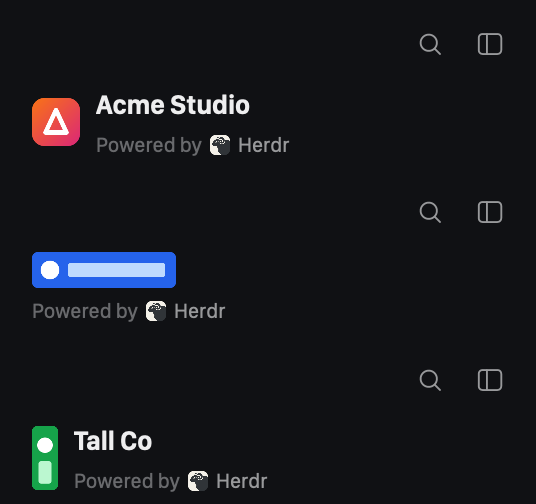

# Custom Brand

Your own logo and name at the top of the sidebar, in place of Herdr's, with a
small "Powered by Herdr" line underneath so the window still credits Herdr. Square,
wide and tall logos all keep their shape, and a wordmark can stand without a name.
It's a drop-in for the brand block of the default `main` layout: the search and
sidebar buttons stay.



The preview shows three copies in the two-row arrangement, stacked for comparison:
a square logo with a name, a wide wordmark with no name, and a tall logo with a name.
The macOS traffic lights are left out because Herdr's screenshots don't include
them. They sit in the empty top-left of each copy.

## What you see

The sidebar's top block, on the `chrome` background. It has two arrangements, chosen
by the block's height:

- **Two rows** (block 72px or taller; 96px recommended):
  - Top row, 44px: empty on the left, where macOS draws its traffic lights. Search and
    the sidebar toggle sit on the right, 10px in.
  - Under it, the brand, 16px from the left edge so it lines up with the "Spaces"
    heading and the space icons below, centered in the rest of the height with 6px
    bottom padding.
- **One row** (the default 46px): the brand, then search and the toggle on the right.
  The left padding is 14px, or 76px on macOS to clear the traffic lights. Right
  padding is 10px.

The brand:

- **Logo**: your image at its own aspect ratio. Only its height is set (30px next to
  a name, 24px for a wordmark with no name, or `logo_height`). A logo wider than the
  space it has shrinks to fit that width, still at its own aspect ratio and centered
  in its height, so a very wide wordmark is never cut off. The default
  `mods/custom-brand/logo.svg` is an orange-to-pink (`#f97316` → `#db2777`) rounded
  square with a white triangle outline.
- **With a name**: the logo, then 8px to its right a column with the name above the
  byline, 1px apart. The name is 13.5px semibold in `foreground`, cut off with an
  ellipsis when there's no room. The name and the byline both have line height 1.2,
  so they sit close together.
- **Without a name** (`"name": ""`): the logo with the byline 3px under it, both
  left-aligned. This is for wordmarks.
- **Byline**, 10.5px, its parts 3px apart: `Powered by` in `dim`, Herdr's app icon
  (`frame/welcome/herdr.png`, 12×12px, corners rounded 3px), then `Herdr` in `muted`.
  It can't be turned off. When the row is short of room, `Powered by` shortens
  (`Powere…`) first. The icon and `Herdr` stay whole.
- Anything else too wide (a long name) is clipped at the brand's edge, so it never
  pushes the buttons out.

**Buttons**: 26×26px with 15px icons in `muted`, 4px apart. On hover, the background
turns `hover` and the icon `foreground`, with corners rounded 6px.

**Full screen** (`window().fullscreen`): macOS hides the traffic lights, so the
block always shows one row, with the brand 16px from the left edge, lined up with
"Spaces", beside the buttons. A block taller than 58px shrinks to 58px (room for the
30px logo with about 9px above it) and gets its
height back when the window leaves full screen.

**Rail** (sidebar narrower than 160px), in either arrangement: one row with only the
toggle and 6px left padding. On macOS that row is empty, because the traffic lights
fill it.

## How it behaves

- Search runs `mod.open {name: "picker"}`, the shipped space picker.
- The sidebar toggle folds the sidebar to a rail (44px, 76px on macOS) and unfolds it
  to the width it had before (shared `sidebar.width`, default 268). It also sets shared
  `sidebar.collapsed`, as `workspace-chrome` does, so the shipped mods and this one agree.
  On the macOS rail, the agents list's » unfolds it.
- Resizing the block switches the arrangement on the next frame (72px is the line).
- Entering full screen runs `layout.resize {id: <brand block>, px: 58}` and keeps the
  old height in shared `custom-brand.height.<layout name>`. Leaving full screen
  resizes the block back to that height and clears the key.
- Dragging an empty part of the block moves the window, and double-clicking it
  maximizes. That comes from the layout block's `window_drag`. The buttons stop the
  press, so clicking them doesn't drag.
- Nothing else is clickable, and the byline doesn't link anywhere.
- No agent statuses: it shows the same thing whether agents are working, blocked,
  done or idle.
- Follows the theme, light and dark. Nothing animates.

## Built from

- `mods/custom-brand/mod.json`: `{ "place": "none" }`. It only shows where a layout
  puts it.
- `mods/custom-brand/main.js`: one `View` with no `init` and no timers. A rewrite of
  the header half of the shipped `workspace-chrome` (its `footer` half isn't copied)
  with the brand swapped:
  - Props (all optional): `name` (text; `""` for a wordmark), `logo` (an image path
    relative to `~/.config/herdr-app`, SVG or PNG), `logo_height` (px).
  - The root has `.id("root").on_size_change(...)`, which keeps `this.height` up to
    date. Height 72 or more, when not on the rail and not in full screen, gives two rows.
  - `fitHeight(fullscreen)`, called from `render`: finds the first block in `layout()`
    whose `content.mod` is `custom-brand`, and resizes it as described above. Both
    branches are guarded (`px > 58`, or a saved height with `px === 58`), so running on
    every render is safe.
  - `narrow()` finds the `sidebar` node in `layout()` and checks whether its `size.px`
    is under 160.
  - Herdr: `theme`, `run`, `props`, `window` (`platform === "macos"`), `shared`,
    `setShared`, `layout`; commands `mod.open` and `layout.resize`.
  - gpui-kit: `div`, `image` (logo, Herdr icon), `svg` (button icons); gpui-base:
    `h_flex`, `v_flex`.
- `mods/custom-brand/search.svg`, `sidebar.svg`: copies of the shipped
  `workspace-chrome` icons (Lucide-style, 24×24 viewBox, `currentColor` strokes).
- `mods/custom-brand/logo.svg`: the placeholder logo, 64×64.
- No `keys.json`: it adds no keys. It runs no programs, makes no network calls and
  reads only images: the logo you name, its own icons and Herdr's
  `frame/welcome/herdr.png`.

To use it, clone `main` and point the clone's `brand` block at it:

```sh
herdr-app do layout.clone '{"name":"main","as":"my-main"}'
```

Then, in `layouts/my-main.json`, set `size.px` to 96 for the two-row arrangement (it
mainly helps on macOS), or keep 46 for one row:

```json
{ "id": "brand", "type": "block", "size": { "px": 96 }, "window_drag": true,
  "content": { "mod": "custom-brand",
               "props": { "name": "Acme Studio", "logo": "my-brand/logo.svg" } } }
```

For a wordmark: `"props": { "name": "", "logo": "my-brand/wordmark.svg" }`. Add
`"logo_height": 40` for a tall logo that looks too small. Keep your logo outside
`mods/custom-brand/` (here `~/.config/herdr-app/my-brand/`), so updating the mod
doesn't overwrite it. Leave the `sidebar-footer` block on `workspace-chrome` with
`{ "footer": true }`.

## Watch out

- Shipped layouts are read-only, and `layout.set` on them changes only clicks and
  looks. The brand block can only be swapped in a layout of your own. That also means
  it doesn't follow later changes Herdr makes to `workspace-chrome`'s header.
- Give the logo `max_w("100%")` as well as its height. A width that runs out then
  shrinks the box, and the image is drawn contained in it, so a very wide logo scales
  down instead of being cut off.
- Size the logo with height only. `image()` has no object-fit: setting both width and
  height stretches the logo, and `.size(n)` squashes anything that isn't square.
  Height alone keeps its aspect ratio.
- Set line height 1.2 on the name and the byline. Herdr's default line height leaves
  a visible gap between them, even with `gap(1)`.
- Every image in a flex row needs `flex_none()`, or the row squeezes it to a dot.
- In the column for a wordmark, use `items_start()`. With the default stretch, the logo
  is stretched to the column's width.
- On macOS, one row at the default 268px sidebar leaves the brand about 120px.
  `Acme Studio` plus a full byline doesn't fit, which is why `Powered by` shortens.
  Two rows give it the full width.
- `herdr-app shot` returns the last frame drawn, and Herdr stops drawing while its
  window is covered. Bring the window to the front before a shot, or edits seem to do
  nothing. Images also load a moment after a reload, so wait a few seconds.
- Paths for `image()` resolve against `~/.config/herdr-app`, not the mod folder:
  `mods/custom-brand/logo.svg`, not `./logo.svg`.
- The byline uses Herdr's icon from `frame/`, which Herdr rewrites on every start. If a
  future version moves or renames `frame/welcome/herdr.png`, the icon goes blank and
  the text stays.
- The full-screen resize is a layout click, so it lands in `layouts/.state/`, not in
  your layout file. If Herdr quits while in full screen, it starts at 58px with the
  saved height still in shared state, and leaving full screen restores it. Only the
  first `custom-brand` block in a layout is resized.
- Key the saved height by layout name. Layouts can give the block different heights,
  and one shared key would restore the wrong one after a layout switch.
- If you rename the mod folder, change the `mods/custom-brand/` paths in `main.js`
  (icons and the default logo) to match.

## Done when

- `herdr-app check ~/.config/herdr-app/mods/custom-brand` passes, and
  `herdr-app status` lists no errors with the clone shown.
- At 96px, a `herdr-app shot` (window in front) shows the buttons on the top row and
  the logo's left edge lined up with the "Spaces" heading. At 46px it shows one row.
- A 12:1 wordmark (480×40) shows whole, both ends visible, scaled to the brand's width.
- A square logo (64×64), a wide one (200×50) and a tall one (40×100) each keep their
  shape. A wide wordmark with `"name": ""` sits over the byline.
- In a 268px sidebar on macOS with one row, the byline shows `Powere…` and the icon
  and `Herdr` stay whole.
- Changing `name`, `logo` or `logo_height` in the layout file changes the block within
  a second. Leaving all three out shows `Acme` with the placeholder logo.
- In full screen, a 96px block becomes one 58px row with the brand at 16px, and
  leaving full screen brings back 96px and two rows.
- Search opens the space picker. The toggle folds the sidebar to a rail and back to
  its old width. On the rail, only the toggle shows (on macOS, nothing).
- In a light theme (`app.theme {name: "paper"}`), the name, byline and icons are still
  readable.
